# Kelişuv

Özbekiston uçun mediatsiya, huquqiy yönaltiriş va kelişuvni rasmiylaştiriş platformasi.

## Xakaton taqdimoti

[PowerPoint’ni yuklaş](presentations/Kelishuv-hackathon-final.pptx) · [PDF’ni köriş](presentations/Kelishuv-hackathon-final.pdf)

Yakuniy taqdimotning 12 ta slaydi quyida ketma-ket berilgan.

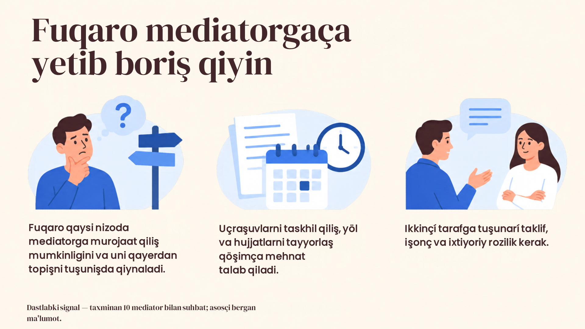

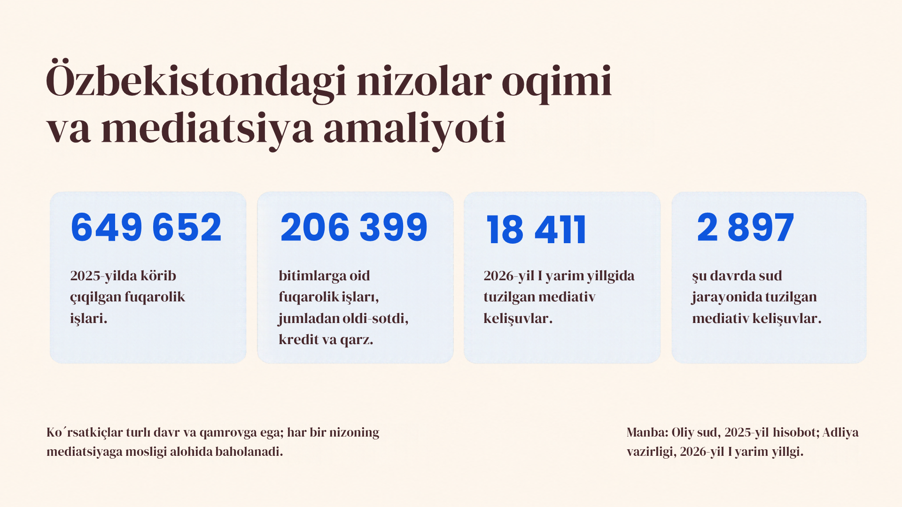

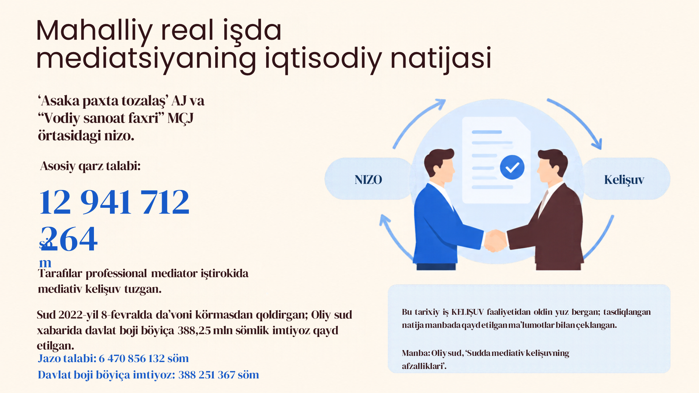

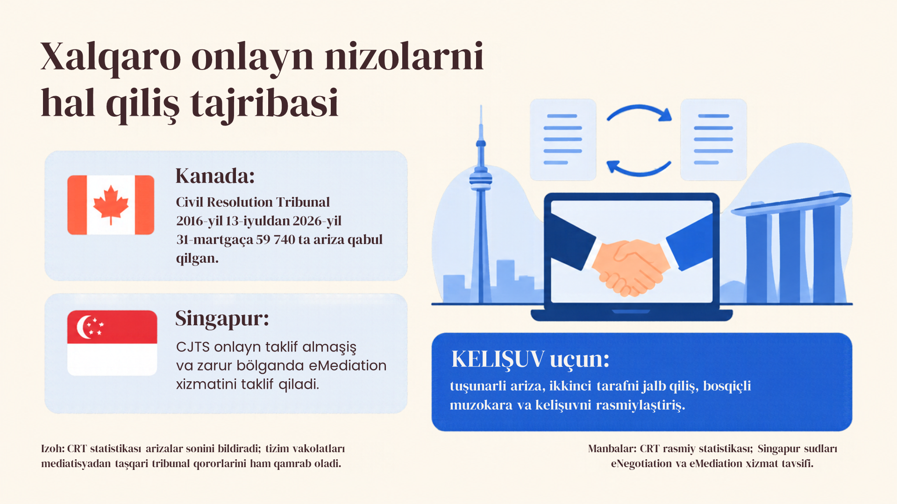

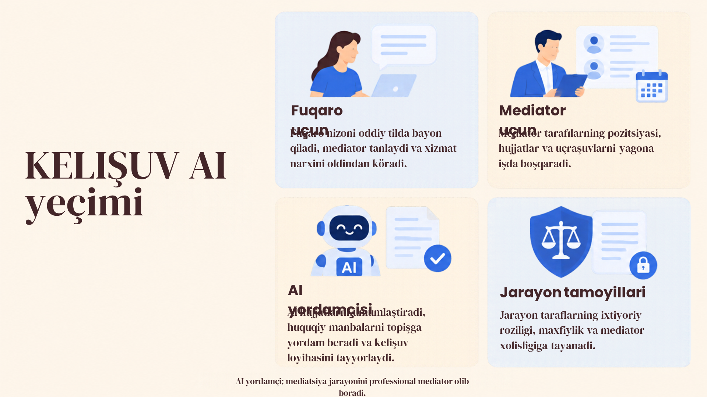

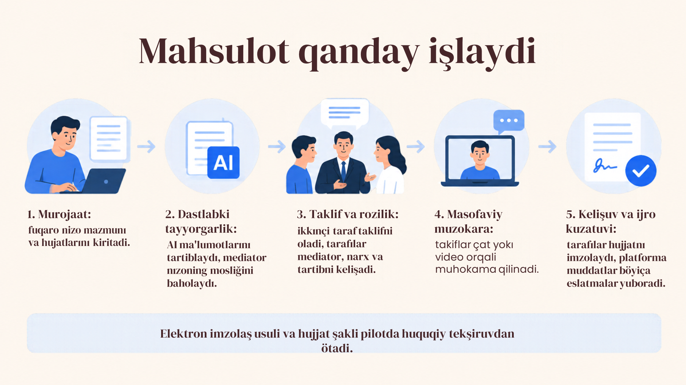

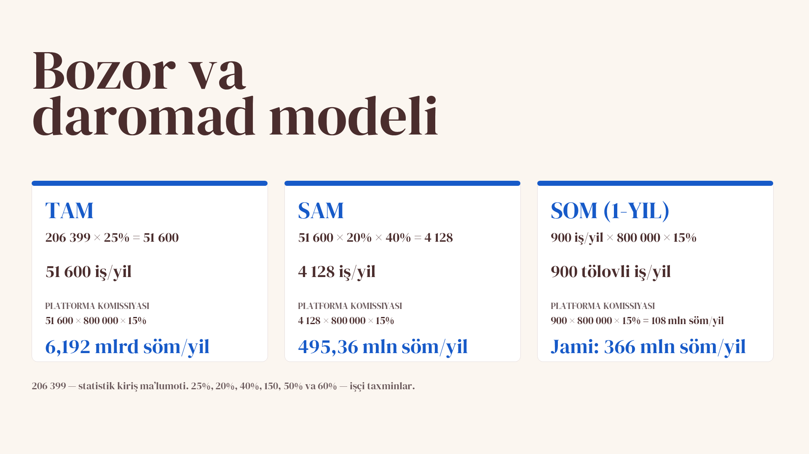

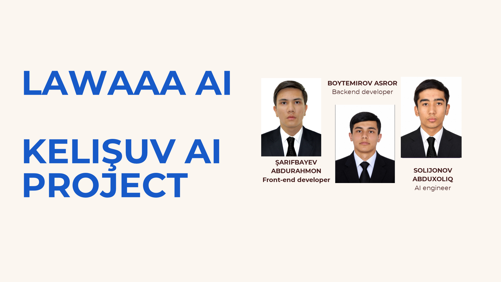

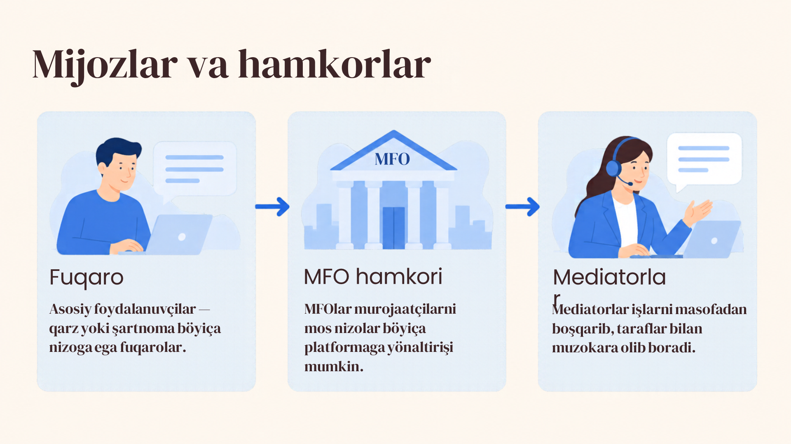

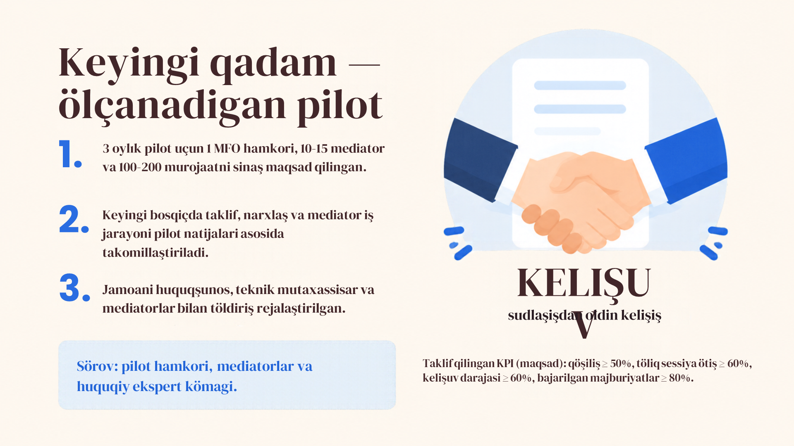

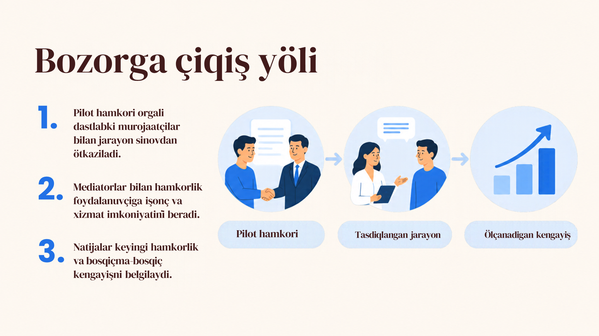

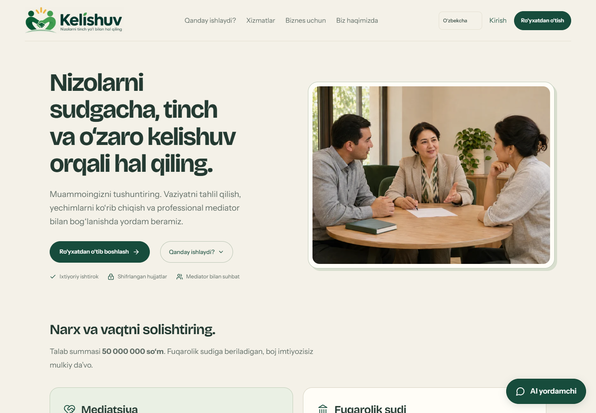

[Rasmli PDFni yuklaş](Kelishuv-platforma.pdf) · [Namoyişni oçiş](https://armadillo-writing-sanctuary.ngrok-free.dev/welcome) · [Arxitektura rasmi](assets/architecture.png)

Muallif va loyiha egasi **Abduxoliq Solijonov**. 2026-yil 21-noyabr holati. Uşbu ommaviy repozitoriy loyiha taqdimoti, interfeys rasmlari va arxitektura materiallarini jamlaydi. Dastur manba kodi [oçiq repozitoriyda](https://github.com/Albeerte/kelishuv-ai) saqlanadi. Namoyiş havolasi kompyuter va tunnel işlayotgan paytda faol.

## Platforma nima qiladi

Foydalanuvçi muammoni yozadi va dalillarini yuklaydi. Qarşi taraf öz hisobidan bayonini kiritadi. Tizim huquqiy manbalarni körsatadi, navbatdagi kelişuv takliflarini beradi va taraflar roziligiga köra şahar hamda ixtisoslikka mos mediator bilan işlaşni taşkil etadi.

- Telefon bilan röyxatdan ötiş, pasport yuklaş va şaxsni tekşiriş bosqiçlari.
- Telefon yoki emailga boğlangan taklif va ikki mustaqil bayon.
- Törtta navbatdagi kelişuv taklifi va har ikki tarafning javobi.
- Umumiy çat, mediator bilan maxfiy muloqot va sessiya rejalaş.
- Hujjatni öqiş, qölda imzo, PDF/DOCX nusxalari va ijro kuzatuvi.
- Lex.uz manbalariga tayangan yordamçi va xarajatlar kalkulyatori.

Özbekça matnlar foydalanuvçi yuborgan harflar namunasiga moslandi. `G‘/g‘ → Ğ/ğ`, `O‘/o‘ → Ö/ö`, `Sh/sh → Ş/ş` va `Ch/ch → Ç/ç` almaştirişlari interfeys, logo, AI javoblari va taqdimotlarda qöllanadi. Qidiruv ikkala yozuvni qabul qiladi.

## Sayt körinişi

Yirik tipografika, yaşil brend va iliq fon işlatilgan. Foydalanuvçi kabinetining asosiy amali “Yangi muammo boşlaş” tugmasidir. Özbek lotin, özbek kirill va rus tillari mavjud. Rasmlar ilovaning haqiqiy interfeysidan namunaviy ma’lumotlar bilan olingan.

### Foydalanuvçi kabineti

### Mediator kabineti

### Administrator paneli

### Huquqiy yordamçi va mobil köriniş

| Lex.uz manbalari bilan javob | Mobil sahifa |
| --- | --- |
|  | 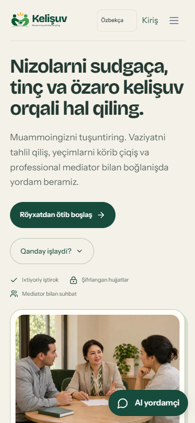 |

## Tizim arxitekturasi

Asosiy lokal yöl Next.js 15, React 18 va TypeScript interfeysini server APIlari, ruxsat nazorati va şifrlangan saqlaş bilan birlaştiradi. AI bilan işlaş Ollama adapteri orqali bajariladi. Hujjatlar PDF/DOCX körinişida yaratiladi, imzolaş versiya va audit bilan qayd etiladi.

| Qatlam | Texnologiya va vazifa |
| --- | --- |
| Interfeys | Next.js 15, React 18, TypeScript, Tailwind, Radix, Zustand |
| Server | Next.js API, NextAuth, Zod, rol va rozilik nazorati |
| Mahalliy model | Ollama, `qwen3-vl:8b-instruct`, matn va tasvir işlovi |
| Huquqiy RAG | 25 hujjatdagi 7 368 modda, Orama BM25, lokal BGE-M3, Lex.uz jonli tekşiruvi |
| Saqlaş | AES-256-GCM bilan şifrlangan yozuvlar va fayllar, scrypt parol xeşlari |
| Hujjatlar | PDF, DOCX, qölda imzo, versiyalar, audit, ijro rejasi |
| Ixtiyoriy infratuzilma | PostgreSQL, Redis, S3/MinIO, FastAPI/Qdrant |

### FastAPI va Qdrant varianti

Sxema ixtiyoriy FastAPI/Qdrant infratuzilma variantini körsatadi. Joriy MVPning asosiy yöli Next.js API, lokal Ollama, Orama BM25 va BGE-M3 orqali işlaydi. FastAPI/Qdrant va PostgreSQL servislarini işga tuşiriş tegişli konfiguratsiyaga boğliq.

## Yordamçining yangi imkoniyatlari

Kabinetdagi “AI yordamçi” har bir hisobga jami 10 ta bepul sörov ajratadi. Orama BM25 va lokal BGE-M3 qidiruv modeli topgan moddalar Lex.uz dagi joriy matn bilan tekşiriladi. Qwen manba identifikatorlariga boğlangan javob yaratadi. Saqlangan korpusning dastlabki sanasi 2026-yil iyul. Jonli tekşiruv bajarilmagan manba kartasida saqlangan nusxa belgisi körinadi. [Orama](https://github.com/oramasearch/orama), [BGE-M3](https://ollama.com/library/bge-m3), [CC0 huquqiy korpus](https://github.com/javohirmat/uzbek-legal-corpus)

Oliy sudning oçiq maqolalari va Lex.uz dagi Plenum qarorlari qöşimça dalil beradi. Individual sud qarorlari bazasiga ulaniş uşbu muhitda tekşirilmadi. [Oliy sud](https://sud.uz/), [Fuqarolik işlari böyiça Plenum qarorlari](https://sud.uz/la/plenum-la/documents-civil-la/)

Taklif havolalari töliq HTTPS manzili bilan yaratiladi. Qarşi taraf taklifdagi telefon yoki emailga mos hisob orqali qöşiladi. Murojaatni qaytarib oliş va mustaqil kelişuv sababli yopiş mavjud. Qarşi taraf qöşilgan bölsa, mustaqil kelişuvni ikkala taraf tasdiqlaydi.

## Işlatilgan lokal model

Lokal muhitda **Qwen3-VL-8B-Instruct** modeli Ollama orqali işlatilgan. Uşbu kompyuterda `qwen3-vl:8b-instruct` modeli mavjudligi tekşirilgan. U bayonni tahlil qiliş, hujjat va rasmdan ma’lumot ajratiş hamda strukturali javob tayyorlaş uçun işlatiladi. Qaytgan natija serverda sxema, manba identifikatorlari va hisob-kitob qoidalari bilan tekşiriladi. [Qwen model kartasi](https://huggingface.co/Qwen/Qwen3-VL-8B-Instruct), [Ollama çat API](https://docs.ollama.com/api/chat)

### TATU serveridagi 14 soatlik öqitiş tajribasi

Loyiha jamoasi taqdim etgan ma’lumotga köra, **TATU serverida Lex.uz va boşqa huquqiy saytlardan tayyorlangan ma’lumotlar bilan 14 soatlik model öqitiş tajribasi ötkazilgan**. Server, davomiylik va öqitiş manbalari haqidagi uşbu bayon loyiha egasining ma’lumotiga tayangan.

Amaldagi lokal işga tuşiriş konfiguratsiyasi Ollama orqali `qwen3-vl:8b-instruct` modeliga ulanadi. TATU tajribasining usuli, server apparati va yakuniy çeckpointi böyiça texnik ma’lumotlar loyiha jamoasi tomonidan taqdim etiladi.

## Huquqiy manbalar bilan işlaş

Mediator iş maydonidagi yönaltiriş katalogi 11 ta rasmiy hujjatdan olingan 33 ta tanlangan moddani saqlaydi. Har bir yozuvda asl Lex.uz havolasi, modda, tahrir yoki tekşiruv sanasi va kontent xeşi mavjud. Katalogning qayd etilgan holati 2026-yil 20-noyabr. Yangilaş jarayoni manba oliş, matn ajratiş, tekşiriş va katalog yoki vektor indeksiga tayyorlaş bosqiçlarini qamraydi. [Lex.uz](https://lex.uz/), [Mediatsiya töğrisidagi qonun](https://lex.uz/docs/-3805227)

Yordamçi javobda katalogdagi manbalarni körsatadi. Taraflar bayoni, hujjatlari va kelişuvni yakunlaş mediatorning iş maydonida körib çiqiladi. Ommaviy namoyiş yordamçisi 25 hujjat va 7 368 moddali korpus, BGE-M3 va BM25 qidiruvi, Lex.uz jonli matnlari va lokal Qwen orqali işlaydi. Model izohidagi raqamlar va foizlar tegişli manbada uçraşi tekşiriladi.

## Hujjatlar va xizmat modeli

| Xizmat | Boşlanğiç tarif |
| --- | --- |
| Talabnoma | 19 000 söm |
| Mediatsiya uçun ariza | 29 000 söm |
| Da’vo arizasi loyihasi | 49 000 söm |
| Platformaning mediator xizmatidan uluşi | 15% |

Hujjat tarifi AI bilan töldiriş va DOCX yuklaşni qamraydi. Mediator haqi taraflar bilan yozma kelişilgan hisobdan olinadi. Boşlanğiç hisob-kitobda taraflar teng uluş tölaydi. Tariflar mahsulot uçun tanlangan boşlanğiç qiymatlardir.

## Integratsiyalar holati

Eskiz SMS, Face ID bridge, Payme Merçant API va Zoom OAuth adapterlari tayyorlangan. Haqiqiy servislar biznes hisoblari va API sozlamalari ulanişini kutmoqda. Face ID provayderining SDK hamda autentifikatsiyasi bridge bilan moslaştiriladi. Mediatorga bank orqali pul çiqariş biznes hisob-kitob sozlamalariga boğliq.

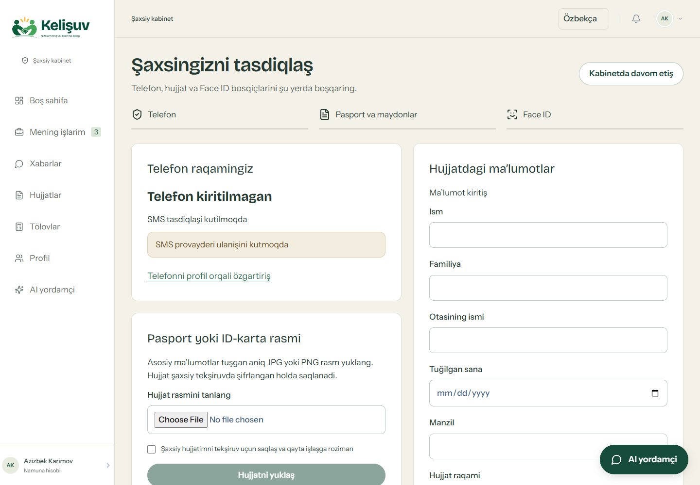

## Tekşiruv natijalari

- 66 ta saqlangan regressiya testi ötdi.
- Sönggi kengaytma uçun ikki hisobli 8 ta brauzer jarayoni tekşirildi.
- Yangi sahifalardagi 18 ta avtomatik WCAG auditida nol xato qaytdi.
- Production build, TypeScript va ESLint tekşiruvlari ötdi.
- Production dependency auditida nol zaiflik qaytdi.
- Dizayn ekstraktori uçun 9 ta regressiya testi ötdi.

Natijalar şu loyiha versiyasi va körsatilgan avtomatlaştirilgan tekşiruvlar doirasiga tegişli. Huquqiy tahlilning amaliy bahosi mediator körigida aniqlanadi.

## Materiallar

- [Yakuniy PowerPoint](presentations/Kelishuv-hackathon-final.pptx)
- [Yakuniy taqdimot PDF](presentations/Kelishuv-hackathon-final.pdf)
- [Biznes modeli va raqobat dalillari](docs/PITCH_EVIDENCE.md)
- [8 sahifali rasmli PDF](Kelishuv-platforma.pdf)
- [Arxitektura rasmi](assets/architecture.png)
- [Lokal AI oqimi](assets/local-ai.png)
- [Foydalanuvçi jarayoni](assets/workflow.png)
- [Barça ekran rasmlari](assets/)

Lokal dastur `http://localhost:2345` manzilida işlaydi. Manba kodini [GitHub’dan köriş mumkin](https://github.com/Albeerte/kelishuv-ai).
