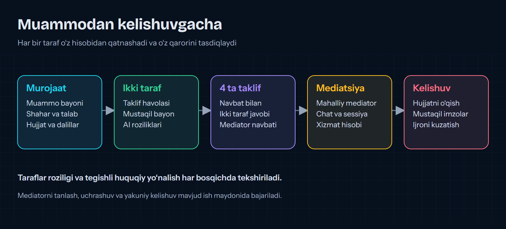
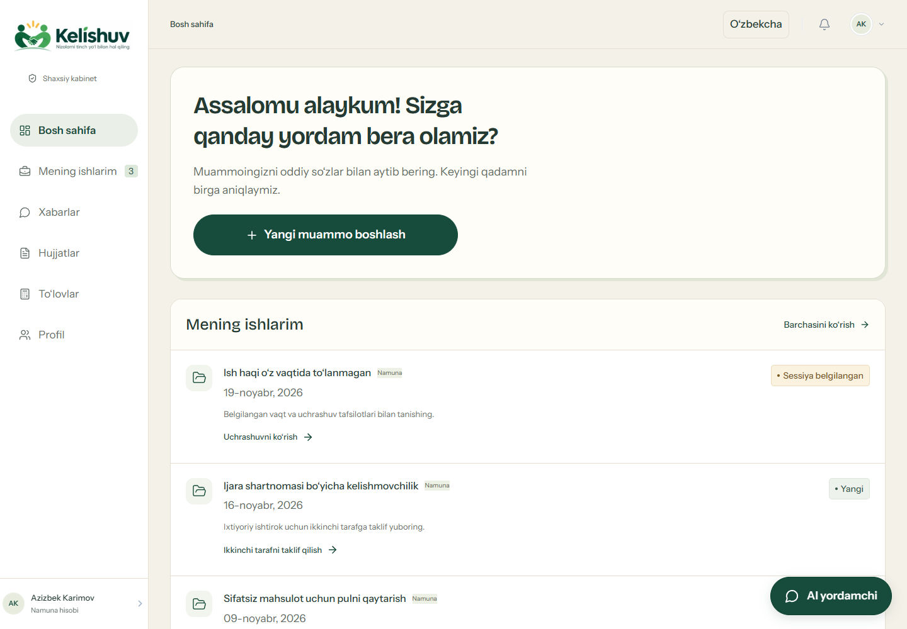
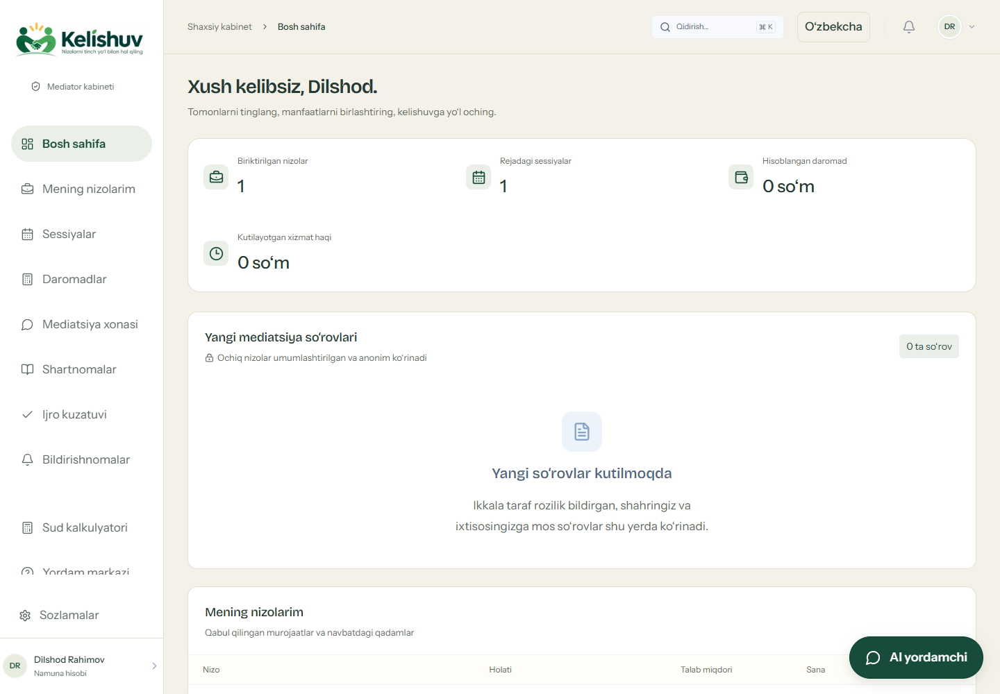
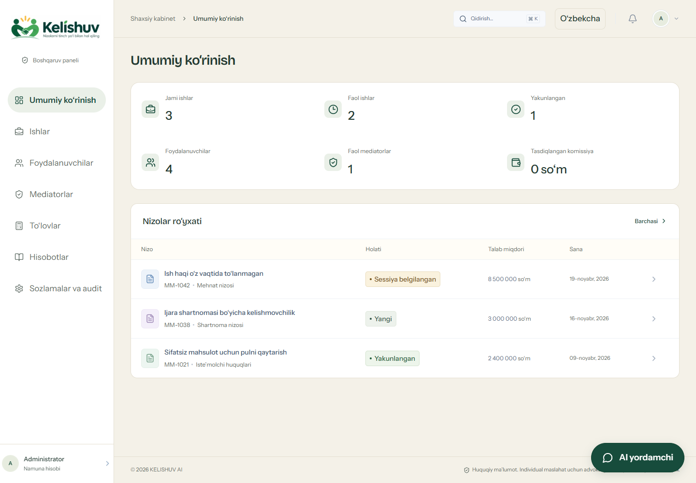
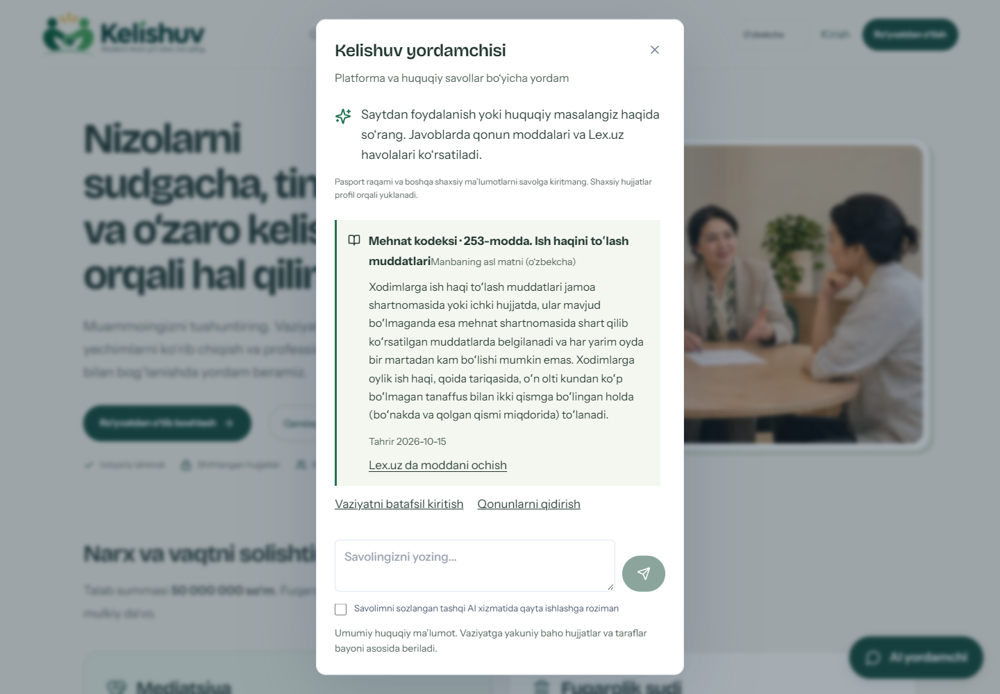
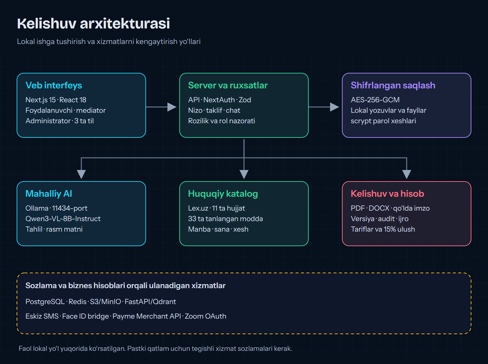
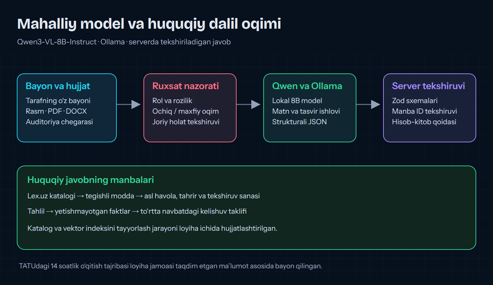
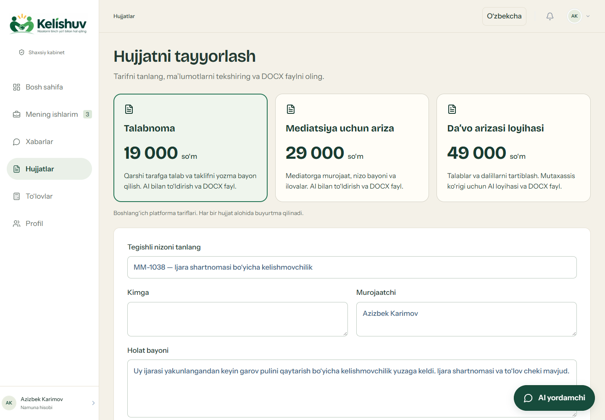

# Kelishuv

O‘zbekiston uchun mediatsiya, huquqiy yo‘naltirish va kelishuvni rasmiylashtirish platformasi.

[Rasmli PDFni yuklash](Kelishuv-platforma.pdf) · [Namoyishni ochish](https://setting-spouse-interested-tar.trycloudflare.com/welcome) · [Arxitektura rasmi](assets/architecture.png)

Muallif va loyiha egasi **Abduxoliq Solijonov**. 2026-yil 21-noyabr holati. Ushbu ommaviy repozitoriy loyiha taqdimoti, interfeys rasmlari va arxitektura materiallarini jamlaydi. Dastur manba kodi private repozitoriyda saqlanadi. Namoyish havolasi kompyuter va tunnel ishlayotgan paytda faol.

## Platforma nima qiladi

Foydalanuvchi muammoni yozadi va dalillarini yuklaydi. Qarshi taraf o‘z hisobidan bayonini kiritadi. Tizim huquqiy manbalarni ko‘rsatadi, navbatdagi kelishuv takliflarini beradi va taraflar roziligiga ko‘ra shahar hamda ixtisoslikka mos mediator bilan ishlashni tashkil etadi.

- Telefon bilan ro‘yxatdan o‘tish, pasport yuklash va shaxsni tekshirish bosqichlari.
- Telefon yoki emailga bog‘langan taklif va ikki mustaqil bayon.
- To‘rtta navbatdagi kelishuv taklifi va har ikki tarafning javobi.
- Umumiy chat, mediator bilan maxfiy muloqot va sessiya rejalash.
- Hujjatni o‘qish, qo‘lda imzo, PDF/DOCX nusxalari va ijro kuzatuvi.
- Lex.uz manbalariga tayangan yordamchi va xarajatlar kalkulyatori.

## Sayt ko‘rinishi

Yirik tipografika, yashil brend va iliq fon ishlatilgan. Foydalanuvchi kabinetining asosiy amali “Yangi muammo boshlash” tugmasidir. O‘zbek lotin, o‘zbek kirill va rus tillari mavjud. Rasmlar ilovaning haqiqiy interfeysidan namunaviy ma’lumotlar bilan olingan.

### Foydalanuvchi kabineti

### Mediator kabineti

### Administrator paneli

### Huquqiy yordamchi va mobil ko‘rinish

| Lex.uz manbalari bilan javob | Mobil sahifa |
| --- | --- |
|  |  |

## Tizim arxitekturasi

Asosiy lokal yo‘l Next.js 15, React 18 va TypeScript interfeysini server APIlari, ruxsat nazorati va shifrlangan saqlash bilan birlashtiradi. AI bilan ishlash Ollama adapteri orqali bajariladi. Hujjatlar PDF/DOCX ko‘rinishida yaratiladi, imzolash versiya va audit bilan qayd etiladi.

| Qatlam | Texnologiya va vazifa |
| --- | --- |
| Interfeys | Next.js 15, React 18, TypeScript, Tailwind, Radix, Zustand |
| Server | Next.js API, NextAuth, Zod, rol va rozilik nazorati |
| Mahalliy model | Ollama, `qwen3-vl:8b-instruct`, matn va tasvir ishlovi |
| Huquqiy katalog | 11 ta rasmiy hujjatdan 33 ta tanlangan modda, manba, sana va xesh |
| Saqlash | AES-256-GCM bilan shifrlangan yozuvlar va fayllar, scrypt parol xeshlari |
| Hujjatlar | PDF, DOCX, qo‘lda imzo, versiyalar, audit, ijro rejasi |
| Ixtiyoriy infratuzilma | PostgreSQL, Redis, S3/MinIO, FastAPI/Qdrant |

## Ishlatilgan lokal model

Lokal muhitda **Qwen3-VL-8B-Instruct** modeli Ollama orqali ishlatilgan. Ushbu kompyuterda `qwen3-vl:8b-instruct` modeli mavjudligi tekshirilgan. U bayonni tahlil qilish, hujjat va rasmdan ma’lumot ajratish hamda strukturali javob tayyorlash uchun ishlatiladi. Qaytgan natija serverda sxema, manba identifikatorlari va hisob-kitob qoidalari bilan tekshiriladi. [Qwen model kartasi](https://huggingface.co/Qwen/Qwen3-VL-8B-Instruct), [Ollama chat API](https://docs.ollama.com/api/chat)

### TATU serveridagi 14 soatlik o‘qitish tajribasi

Loyiha jamoasi taqdim etgan ma’lumotga ko‘ra, **TATU serverida Lex.uz va boshqa huquqiy saytlardan tayyorlangan ma’lumotlar bilan 14 soatlik model o‘qitish tajribasi o‘tkazilgan**. Server, davomiylik va o‘qitish manbalari haqidagi ushbu bayon loyiha egasining ma’lumotiga tayangan.

Amaldagi lokal ishga tushirish konfiguratsiyasi Ollama orqali `qwen3-vl:8b-instruct` modeliga ulanadi. TATU tajribasining usuli, server apparati va yakuniy checkpointi bo‘yicha texnik ma’lumotlar loyiha jamoasi tomonidan taqdim etiladi.

## Huquqiy manbalar bilan ishlash

Amaldagi katalog 11 ta rasmiy hujjatdan olingan 33 ta tanlangan moddani saqlaydi. Har bir yozuvda asl Lex.uz havolasi, modda, tahrir yoki tekshiruv sanasi va kontent xeshi mavjud. Katalogning qayd etilgan holati 2026-yil 20-noyabr. Yangilash jarayoni manba olish, matn ajratish, tekshirish va katalog yoki vektor indeksiga tayyorlash bosqichlarini qamraydi. [Lex.uz](https://lex.uz/), [Mediatsiya to‘g‘risidagi qonun](https://lex.uz/docs/-3805227)

Yordamchi javobda katalogdagi manbalarni ko‘rsatadi. Taraflar bayoni, hujjatlari va kelishuvni yakunlash mediatorning ish maydonida ko‘rib chiqiladi. Ommaviy namoyish yordamchisi katalog va qoidaviy rejimda ishlaydi.

## Hujjatlar va xizmat modeli

| Xizmat | Boshlang‘ich tarif |
| --- | --- |
| Talabnoma | 19 000 so‘m |
| Mediatsiya uchun ariza | 29 000 so‘m |
| Da’vo arizasi loyihasi | 49 000 so‘m |
| Platformaning mediator xizmatidan ulushi | 15% |

Hujjat tarifi AI bilan to‘ldirish va DOCX yuklashni qamraydi. Mediator haqi taraflar bilan yozma kelishilgan hisobdan olinadi. Boshlang‘ich hisob-kitobda taraflar teng ulush to‘laydi. Tariflar mahsulot uchun tanlangan boshlang‘ich qiymatlardir.

## Integratsiyalar holati

Eskiz SMS, Face ID bridge, Payme Merchant API va Zoom OAuth adapterlari tayyorlangan. Haqiqiy servislar biznes hisoblari va API sozlamalari ulanishini kutmoqda. Face ID provayderining SDK hamda autentifikatsiyasi bridge bilan moslashtiriladi. Mediatorga bank orqali pul chiqarish biznes hisob-kitob sozlamalariga bog‘liq.

## Tekshiruv natijalari

- 45 ta saqlangan regressiya testi o‘tdi.
- So‘nggi kengaytma uchun ikki hisobli 8 ta brauzer jarayoni tekshirildi.
- Yangi sahifalardagi 18 ta avtomatik WCAG auditida nol xato qaytdi.
- Production build, TypeScript va ESLint tekshiruvlari o‘tdi.
- Production dependency auditida nol zaiflik qaytdi.
- Dizayn ekstraktori uchun 9 ta regressiya testi o‘tdi.

Natijalar shu loyiha versiyasi va ko‘rsatilgan avtomatlashtirilgan tekshiruvlar doirasiga tegishli. Huquqiy tahlilning amaliy bahosi mediator ko‘rigida aniqlanadi.

## Materiallar

- [8 sahifali rasmli PDF](Kelishuv-platforma.pdf)
- [Arxitektura rasmi](assets/architecture.png)
- [Lokal AI oqimi](assets/local-ai.png)
- [Foydalanuvchi jarayoni](assets/workflow.png)
- [Barcha ekran rasmlari](assets/)

Lokal dastur `http://localhost:2345` manzilida ishlaydi. Kodga kirish loyiha egasi orqali beriladi.
